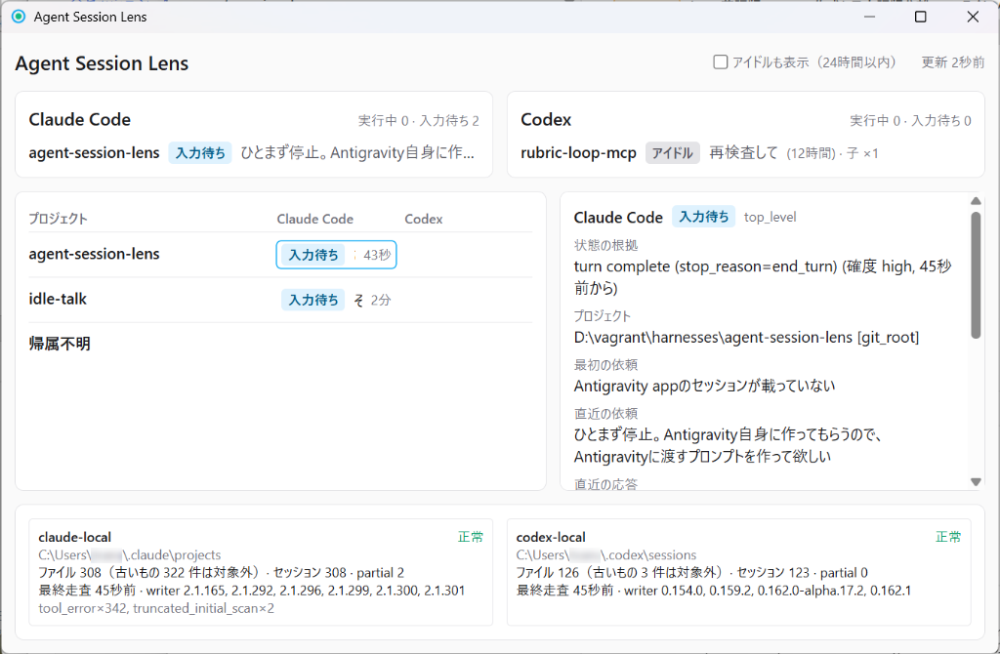
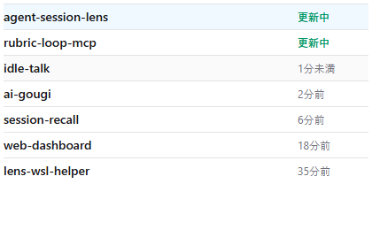

# Agent Session Lens

[English](README.md) | 日本語

> [!WARNING]
> 本プロジェクトは現在開発中（WIP）です。

Claude Code と Codex のローカルセッションログ（読み取り専用）を監視し、プロジェクト単位で「今どのエージェントが何をしているか」を表示するデスクトップアプリ（Tauri + React + Rust）。WSL 上のセッションは `lens-wsl-helper` 経由で取り込みます。

## スクリーンショット

### 通常モード



### コンパクトモード

ウィンドウ幅が 900 px 未満になると、プロジェクト一覧をコンパクトに表示します。



スクリーンショットはサンプルデータを使用しています。

## プロジェクト一覧の操作

- クリック: セッション詳細を表示。
- Shift+クリック: プロジェクトのフォルダをエクスプローラーで開く。
- Ctrl+クリック: そのプロジェクトを開いているウィンドウを前面に出す。
  - エディタ（VS Code / Cursor / Antigravity IDE）はウィンドウタイトルのフォルダ名で照合します。タイトルに `⟨${rootPath}⟩`（[vscode-selector](https://github.com/toaruR/vscode-selector) のパス表示）があればフルパスで照合します。プロジェクト自体を開いているエディタが無い場合は、親フォルダを開いているエディタ（最も近いもの）を代わりに前面に出します（パス表示が必要）。パス表示の無いエディタが開いていると、settings.json の `window.title` に追加するか確認します（変更前は `.bak` に保存。断るとアプリ終了まで再確認しません）。
  - エージェント CLI（Claude Code / Codex / Antigravity の `claude` / `codex` / `agy`）は作業ディレクトリで照合し、それを動かしているターミナルやデスクトップアプリのウィンドウを前面に出します。エディタ内で動くものはエディタ側で扱います。WSL 内のプロセスは対象外です。

## ビルドと実行

前提: Rust（stable）、Node.js、Tauri の前提環境（Windows では WebView2）。

```bash
npm install
npm run tauri dev     # 開発起動
npm run build         # 型検査 + フロントエンドビルド
npm run tauri -- build --no-bundle # 画面を埋め込んだ配布用実行ファイル
cargo test --workspace
```

## 設定（settings.json）

- 場所: `%APPDATA%\agent-session-lens\settings.json`（`APPDATA` が無い場合は `$HOME/.config/agent-session-lens/settings.json`）。
- 形式: `{"version":1, "helperPath"?, "disabledDistros"?, "sourceRoots"?}`。壊れている場合は既定値で起動し、元ファイルを `settings.json.bad` に退避します。
- 通常は UI から変更します。手動編集は反映にアプリ再起動が必要な場合があります。

## WSL ヘルパー

WSL ディストロ内のログは Linux 側の `lens-wsl-helper`（既定 `/usr/local/bin/lens-wsl-helper`、`settings.json` の `helperPath` で変更可）が正規化 NDJSON として送ります。ホスト側は `wsl.exe` 経由で起動・監視します。

監視する各ディストロに、リポジトリのルートから PowerShell で導入します。

```powershell
./scripts/install-wsl-helper.ps1 -Distro Ubuntu
```

指定した WSL 内の Rust でビルドし、WSL の root 権限で `/usr/local/bin` に配置して `--version` を確認します。WSL 側に Rust と C コンパイラーが必要です。Cargo が依存パッケージをダウンロードする場合があります。Windows 側でビルドした実行ファイルは Linux 用ヘルパーには使えません。導入時は指定ディストロを起動しますが、通常の監視では停止中のディストロを起こしません。

`helper_not_found` はヘルパー未配置を表します。配置後はアプリが自動で再試行します。ホスト側コードを更新した場合は、アプリを再ビルドして再起動してください。

実ログで Windows までの受信を確認できます。

```powershell
$env:LENS_TEST_DISTRO = 'Ubuntu'
cargo test -p lens-core --test real_helper_process real_wsl_reads_existing_sources -- --ignored --nocapture
```

初回走査は過去7日が対象です。全ログが古い場合も収集元の正常応答と `skippedOldFiles` を確認できます。セッション到達も必須にする場合は `real_wsl_ingests_existing_sessions` を実行してください。`LENS_TEST_CLAUDE_ROOT` と `LENS_TEST_CODEX_ROOT` で一時的な Linux 側の検証用ディレクトリを指定でき、アプリ設定や実ログは変更しません。

## ドキュメント

- 設計: [docs/architecture-v5.md](docs/architecture-v5.md)
- 実装（公開面・終了コード・設定・既知の注意点）: [docs/implementation-v5.md](docs/implementation-v5.md)

## ライセンス

[MIT License](LICENSE)
